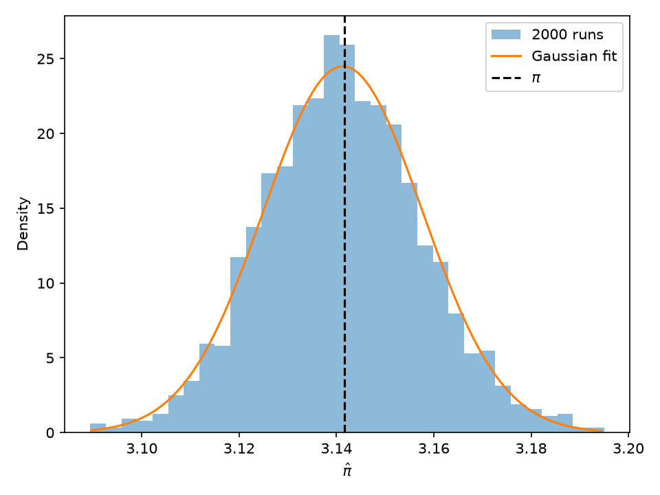
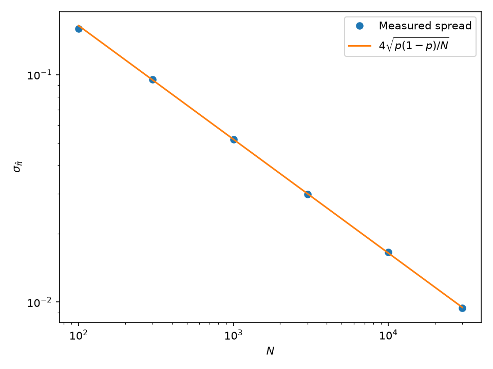

# Ising Model

## How do we estimate pi?

We generate N random points uniformly in the unit square, ($0 \leq x,y < 1$). A point lies inside a quarter-circle of radius r if ($x^2+y^2<r^2$), where ($0<r\leq1$).

The proportion of points inside the quarter-circle approximates its area divided by the square’s area:
$$
\frac{\text{points inside}}{N}\approx\frac{\pi r^2}{4}.
$$


Rearranging gives our estimate:
$$
\hat{\pi}=\frac{4}{r^2}\frac{\text{points inside}}{N}.
$$

```python
def estimate_pi(N, r=1.0):
    x = seed.random(N)
    y = seed.random(N)
    inside = np.count_nonzero(x**2 + y**2 < r**2)
    return 4 / r**2 * inside / N
```

## How accurate are the Monte Carlo estimates?

*These results use 2,000 Monte Carlo estimates for each choice of N and r. Re-running the notebook may give slightly different results*

The number of points inside the quarter-circle is binomial, so for large N the distribution is approximately Gaussian so I chose to fit it to that.

Across $\text{repeats}=2,000$ Monte-Carlo estimates with $N=10,000$, the mean pi estimate was $\hat\pi = 3.1407$, with standard deviation $\hat\sigma = 0.0165$. The expected standard deviation was $\sigma = 0.0164$ so results closely match the theory.

A standard deviation measures the uncertainty of one Monte Carlo simulation with N points. It scales with $\frac{1}{\sqrt N}$ i.e the uncertainty of the average of 2,000 independent estimates is smaller by $\sqrt 2000$





From $\sigma = 4\sqrt{\frac{p(1-p)}{N}} = CN^{-1/2}$, where $C=4\sqrt{p(1-p)}$ and $p=\frac{\pi r^2}{4}$, taking logs gives $$\log \sigma = -\frac{1}{2}\log N + \log C$$

Hence we expect the relationship $\sigma \propto N^{-1/2}$. This means fitting $\log \sigma$ vs $\log N$ should give a gradient of $-0.5$. We find $\text{measured slope} = -0.510$ so our simulation scales with theory.



Comparing two circle radii, we find 

| Radius squared | Relative SD $\times \sqrt{N}$ | Expected value |
| ---: | ---: | ---: |
| 1.000 | 0.539 | 0.523 |
| 0.667 | 0.967 | 0.954 |


where $\text{relative SD}= \frac{SD(\hat\pi)}{\pi}$. As the spread decreases with $\frac{1}{\sqrt{N}}$, we multiply by $\sqrt{N}$ to remove that dependence. The predicted value is

$$\text{relative error} \times \sqrt{N} = \sqrt{\frac{1-p}{p}}$$

Both measured values are close to their predictions. The smaller circle produces a larger relative spread, because fewer points land inside it.

For $N=10{,}000$, $\sqrt N=100$, so the measured relative spreads are 0.539% and 0.967%. The smaller circle therefore gives about 1.8 times as much spread for the same number of points.


## Simulating the Ising Model

### What is the Ising Model? 

It's a simple model of magnetism. In one dimension, it's like a row of tiny magnets. Each one can point in only two directions. Each spin only interacts with it's immediate neighbours.

`↑  ↑  ↓  ↑  ↓  ↓  ↑`

Neighbouring spins have lower energy when they point the same way, i.e an entire aligned row have the lowest possible energy. $J>0$ measures how strongly neighbours interact. Temperature affects how much higher-energy arrangements occur:
- At low temperature, the system strongly favours low-energy arrangements, so neighbours tend to align.
- At high temperature, higher-energy arrangements become more common, so the spins are more disordered.

We join the ends of the rows together to form a ring.

### What is the Metropolis Algorithm?

We need a way to generate spin arrangements with the right probabilities for a given temperature. The Metropolis algorithm does this by repeatedly proposing a small change and deciding whether to accept it.

Each step is:
1. Pick a spin at random.
2. Calculate how much the total energy would change if it flipped. Call this change $\Delta E=E_{\text{after}}-E_{\text{before}}$.
3. If the energy decreases or stays the same, accept the flip.
4. If the energy increases, accept it with probability$P=e^{-\Delta E/T}$

To simplify, we just use units where Boltzmann’s constant $k_B=1$
